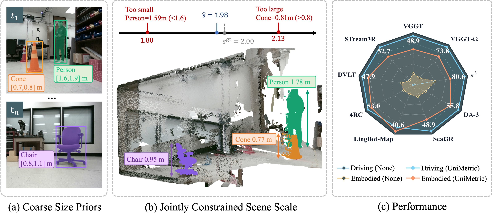

<h1 align="center">UniMetric</h1>
<h3 align="center">Universal Metric Scale Recovery for Visual Geometry Foundation Models</h3>

<p align="center">
  Lei Yang · Yuner Zhang · Ziyang Liu · Ziying Song · Kai Wu · Yiyang Gao · Jiangtao Su · Yiming Li
</p>

<p align="center">
  <a href="https://arxiv.org/abs/2610.16945"></a>
  <a href="https://huggingface.co/datasets/yanglei18/MetricBench"></a>
  <a href="https://www.modelscope.ai/datasets/yanglei_thu/MetricBench"></a>
</p>

<p align="center"><strong>UniMetric code and the MetricBench dataset are available.</strong></p>

**UniMetric** is a training-free framework that recovers metric scale for visual geometry foundation models. It combines uncertain object-size priors from a vision-language model with reconstructed geometry to estimate a shared scale for 3D points and camera translations.

**MetricBench** evaluates metric depth, 3D reconstruction, and camera trajectories across **12 dataset subsets** spanning autonomous driving, roadside perception, and embodied AI. This repository provides adapters for **9 geometry models**, dataset-specific configurations, and evaluation tools.

<p align="center">
  
  <br><em>Coarse object-size priors jointly constrain metric scale, improving metric depth across nine geometry foundation models.</em>
</p>

## Highlights

- **Training-free scale recovery.** Apply semantic size constraints to existing geometry predictions without retraining the underlying model.
- **Three connected stages.** Metric Prior Acquisition extracts height intervals; Semantic–Geometric Alignment converts them into scale constraints; Global Scale Recovery combines them into a shared estimate.
- **Evaluation across geometric outputs.** Measure depth, reconstruction, and camera-motion accuracy while retaining metric scale.

The [technical report](https://arxiv.org/abs/2610.16945) reports the following suite-level mean error reductions across nine models:

| Task | Metric | Mean error reduction |
|---|---|---:|
| Depth estimation | Abs Rel | ↓ 54.2% |
| 3D reconstruction | Chamfer distance | ↓ 83.8% |
| Camera trajectory estimation | Trajectory error | ↓ 65.6% |

These are aggregate results on the evaluated MetricBench subsets; see the paper for individual model/dataset results and evaluation protocols.

## MetricBench

### Download

| Platform | Dataset |
|---|---|
| Hugging Face | [yanglei18/MetricBench](https://huggingface.co/datasets/yanglei18/MetricBench) |
| ModelScope | [yanglei_thu/MetricBench](https://www.modelscope.ai/datasets/yanglei_thu/MetricBench) |

The Hugging Face release contains two archives: `autonomous_driving.zip` (approximately **50.2 GB**) and `embodied_ai.zip` (approximately **7.1 GB**). Download either group or both, with additional disk space for extraction.

After [installation](#installation), use the [Hugging Face CLI](https://huggingface.co/docs/huggingface_hub/en/guides/cli) from the repository root:

```bash
hf download yanglei18/MetricBench \
  autonomous_driving.zip \
  --repo-type dataset --local-dir ./data/metric_bench

for group in autonomous_driving embodied_ai; do
  archive="data/metric_bench/${group}.zip"
  [ -f "$archive" ] || continue
  unzip "$archive" -d data/metric_bench
  if [ -d "data/metric_bench/$group" ]; then
    mv "data/metric_bench/$group"/*/ data/metric_bench/
    rmdir "data/metric_bench/$group"
  fi
done
```

The default nuScenes run below needs `autonomous_driving.zip`. Download `embodied_ai.zip` separately if using an embodied dataset. Alternatively, download the data from the ModelScope page above.

### Dataset layout

Place each dataset directly in **`data/metric_bench/`** under the repository root. The extraction commands above remove the archive's group directory if present. The bundled configurations use this layout directly:

```text
data/metric_bench/
├── Argoverse/
├── dair-v2x-i/
├── KITTI/
├── nuScenes/
├── v2x-radar-i/
├── Waymo/
├── 3EED/
├── CEAR/
├── DROID/
├── FusionPortable/
├── HumanoidEveryday/
└── JRDB/
```

No YAML edits are needed. Run commands from the repository root so that relative paths such as `data/metric_bench/nuScenes` resolve correctly. Each configuration automatically selects its dataset directory below:

| Group | Path under `data/metric_bench/` | Configuration directory |
|---|---|---|
| Autonomous driving | `Argoverse` | [`configs/argoverse/`](configs/argoverse/) |
| Autonomous driving | `dair-v2x-i` | [`configs/dair_v2x_i/`](configs/dair_v2x_i/) |
| Autonomous driving | `KITTI` | [`configs/kitti/`](configs/kitti/) |
| Autonomous driving | `nuScenes` | [`configs/nuscenes/`](configs/nuscenes/) |
| Autonomous driving | `v2x-radar-i` | [`configs/v2x_radar_i/`](configs/v2x_radar_i/) |
| Autonomous driving | `Waymo` | [`configs/waymo/`](configs/waymo/) |
| Embodied AI | `3EED` | [`configs/3eed_dataset/`](configs/3eed_dataset/) |
| Embodied AI | `CEAR` | [`configs/cear/`](configs/cear/) |
| Embodied AI | `DROID` | [`configs/droid/`](configs/droid/) |
| Embodied AI | `FusionPortable` | [`configs/fusionportable/`](configs/fusionportable/) |
| Embodied AI | `HumanoidEveryday` | [`configs/humanoid_everyday/`](configs/humanoid_everyday/) |
| Embodied AI | `JRDB` | [`configs/jrdb/`](configs/jrdb/) |

The benchmark runner reads prepared RGB/point-cloud/calibration bundles for each frame:

```text
nuScenes/
└── <sequence_name>/
    ├── 00000_camera1.jpg     # RGB image
    ├── 00000.pcd             # Ground-truth point cloud
    ├── 00000.yaml            # Camera calibration and pose
    └── ...
```

Use the prepared frame bundles when evaluating on MetricBench. The release consists of benchmark subsets, rather than the complete official test sets of all source datasets.

### Precomputed VLM results

This repository includes **51,339 precomputed VLM responses across all 12 dataset subsets** in a [downloadable archive](precomputed/vlm_results_12datasets.zip). Keep this archive in the cloned repository. The runner automatically extracts missing responses for the selected dataset and sequences into the default cache:

```text
outputs/<dataset>/<sequence>/vlm_outputs/results/<frame>_camera1.json
```

Dataset names match `data/metric_bench/` exactly, including `3EED`, `CEAR`, `HumanoidEveryday`, `KITTI`, and `Waymo`. Images referenced by the responses use portable `data/metric_bench/<dataset>/<sequence>/...` paths. Existing cache files are preserved during extraction.

**No VLM API credentials or YAML edits are needed for frames covered by the cache.** `runtime.reuse_vlm_results` is enabled by default; missing frames use the configured VLM service and require [API credentials](#optional-generate-new-vlm-results). Geometry inference, scale recovery, and evaluation still run with the current configuration.

## Supported models

Each dataset has a `default.yaml` and a configuration for each of the nine model keys below. Select `configs/<dataset>/<model_key>.yaml`; see the [configuration matrix](docs/config-matrix.md) for details.

| Geometry model | Configuration key | Weights under `pretrained_model/` |
|---|---|---|
| Pi3 / Pi3X | `pi3_long` | `Pi3X/` |
| VGGT | `vggt_long` | `VGGT-1B/` |
| VGGT-Omega | `vggt_omega_long` | `VGGT-Omega/vggt_omega_1b_512.pt` |
| Depth Anything 3 | `da3_long` | `DA3-LARGE/` |
| Scal3R | `scal3r_long` | `Scal3R/scal3r.pt` |
| LingBot-Map | `lingbot_map_long` | `LingBot-Map/lingbot-map-long.pt` |
| 4RC | `4rc_long` | `4RC/` |
| DVLT | `dvlt_long` | `DVLT/` |
| STream3R | `stream3r_long` | `STream3R/` |

The current `pi3_long` adapter initializes Pi3X. Model implementations and weights are obtained separately; UniMetric does not require its own trained checkpoint.

## Installation

Use **Linux x86_64 with glibc >= 2.31** (for example Ubuntu 20.04 or newer), **Conda/Miniforge**, **Git**, and a **CUDA-capable NVIDIA GPU** with a compatible driver. Eight GFMs share the Python 3.11 environment **`unimetric`**; only DVLT uses **`unimetric-dvlt`**. The installer prepares PyTorch, UniMetric dependencies, SAM 2, and the selected model checkpoints in the default directories.

```bash
git clone https://github.com/yanglei18/UniMetric.git
cd UniMetric

# Install all nine backends, SAM 2, and their checkpoints
bash scripts/install_gfm.sh
conda activate unimetric
```

With no arguments, the installer automatically installs all nine backends and their checkpoints into the two environments. No model or environment selection is needed. The main program defaults to LingBot-Map on nuScenes in `unimetric`.

VGGT-Omega weights require approval on the [Hugging Face model page](https://huggingface.co/facebook/VGGT-Omega). Obtain access and supply `HF_TOKEN` before installation; the installer cannot grant access to gated weights. After access is granted, rerunning the same command resumes installation.

The shared environment uses **PyTorch 2.6.0 / torchvision 0.21.0 / cu124 / NumPy 1.26.4**. **DVLT uses PyTorch 2.5.1 / cu124 and its own NumPy 2 / Open3D 0.19 dependencies.** Source commits, weight revisions, and dependency versions are specified in [`scripts/gfm_profiles.json`](scripts/gfm_profiles.json). Adding another shared model reuses `unimetric` and resolves and checks its dependencies together with previously recorded models. Switch environments only for DVLT.

The installer runs `pip check`, imports the selected backend, checks NumPy/Torch/Open3D interoperability, and performs a small CUDA operation. To also load the GFM checkpoint, add `--load-model`; this requires enough GPU memory. These checks do not run the benchmark or call a VLM. See the [environment guide](docs/gfm-environments.md) for reruns, download-only recovery, and installation options.

After installation, download [MetricBench](#metricbench). The bundled VLM results are prepared automatically when running; API credentials are only needed for missing or newly generated responses. No YAML path edits are needed. Optional model selections are described [below](#optional-model-selection).

The default resource layout is:

```text
UniMetric/
├── data/metric_bench/          # Extracted benchmark data
├── pretrained_model/          # Geometry model weights (see table above)
├── checkpoints/
│   └── sam2.1_hiera_large.pt
├── precomputed/               # Bundled portable VLM response archive
├── vendor/                    # Third-party model source
├── outputs/                   # Restored VLM cache and generated results
├── p3_images/                 # Prepared images, created during execution
└── tmp/                       # Inference temporary files
```

## Quick start

After the default installation, prepare `data/metric_bench/nuScenes/` using the download instructions above. **There is no need to copy or edit a YAML file.**

### 1. Run UniMetric

Activate the shared environment and run from the repository root:

```bash
conda activate unimetric
python get_metric_scale.py
```

The default is LingBot-Map on nuScenes using `configs/nuscenes/lingbot_map_long.yaml`, including its existing sequence selection and frame coverage. Matching precomputed VLM JSON is restored and reused automatically before model inference, without initializing a VLM client.

The runner executes the full pipeline and saves evaluation reports:

```text
Cached VLM height priors and planes → SAM masks → prepared images
→ geometry prediction → metric scale recovery → evaluation
```

The supplied configuration also determines GPU scheduling and output cleanup.

### 2. Read the results

Results for the default run are saved automatically under `outputs/nuScenes/`:

```text
outputs/nuScenes/
├── <sequence_name>/
│   ├── vlm_outputs/results/
│   └── sam_outputs/
└── metric_results/lingbot_map_long_<run_id>/
    ├── dataset_summary.json
    ├── dataset_summary.txt
    └── sequences/
        ├── <sequence_name>.json
        └── <sequence_name>.txt
```

`run_id` is a timestamp by default. Geometry intermediates are written under each sequence's model output directory; configurations with automatic cleanup enabled remove them after saving metrics. VLM and SAM caches remain available.

### Optional: generate new VLM results

For frames missing from the cache, the default Doubao configuration needs credentials and an endpoint supporting the configured model:

```bash
export DOUBAO_API_KEY="<your-api-key>"
export DOUBAO_BASE_URL="https://<your-provider-host>/v1"
```

Humanoid Everyday's Qwen API configurations read `MODEL_KEY` and `BASE_URL` instead. Credentials stay in environment variables. New VLM requests send images to the selected service and use its API quota. To deliberately regenerate cached responses, set `runtime.reuse_vlm_results: false` while leaving `runtime.resume_existing_results: false`.

### Optional model selection

The default installation includes every backend. Run another supplied YAML to use it; DVLT requires activating `unimetric-dvlt`. Explicit installer selections are available only when you prefer to install a subset.

| Conda environment | Installer names |
| --- | --- |
| `unimetric` | `pi3`, `vggt`, `omega`, `da3`, `scal3r`, `lingbot`, `4rc`, `stream3r` |
| `unimetric-dvlt` | `dvlt` |

```bash
# Use another backend after the default installation
conda activate unimetric
python get_metric_scale.py --config configs/nuscenes/pi3_long.yaml

# DVLT runs in its already installed second environment
conda activate unimetric-dvlt
python get_metric_scale.py --config configs/nuscenes/dvlt_long.yaml
```

For a partial installation, model names such as `pi3 da3` or the group `common` can be passed explicitly. `all` is equivalent to omitting arguments. See the [environment guide](docs/gfm-environments.md) for further options.

## Evaluation and reproduction

The commands above include evaluation. Use the supplied dataset/model YAML to keep its production algorithm settings and frame-selection protocol.

| Paper comparison | Geometry output | JSON variant key |
|---|---|---|
| None / baseline | `relative_scale` | `relative` |
| UniMetric | `optimized_scale_original` | `optimized_original` |

Depth reports include Abs Rel and δ₁; reconstruction reports include Chamfer distance; trajectory reports include ATE. Pose alignment uses SE(3), without fitting an additional scale to ground truth. Other scale variants are available for analysis; see the [evaluation guide](docs/evaluation.md) and [semantic-scale guide](docs/semantic-scale.md).

For reproducible comparisons, retain the exact input subset, effective YAML, model/checkpoint versions, VLM settings and cached responses. The bundled responses are reused by default to avoid variation from repeated API calls; their original semantic predictions are preserved. Full reuse of SAM/depth/metric outputs remains opt-in with `runtime.resume_existing_results: true`, and requires matching inputs and configuration. Detailed setup and runtime options are in the [reproducibility guide](reproducibility/README.md) and [runbook](docs/runbook.md).

<details>
<summary>Configuration and regression checks</summary>

After installing the required dependencies, run:

```bash
python reproducibility/test_prompts.py
python reproducibility/test_supported_models.py
python reproducibility/test_active_features.py
python -m pytest -q tests/test_omega_balanced_preprocess.py tests/test_omega_dataset_intrinsics.py
```

`python reproducibility/check_setup.py` inspects the entire bundled configuration matrix, so it can report missing resources for datasets or models you have not installed. These checks complement a real inference run; they do not reproduce paper metrics.

</details>

## Repository structure

```text
UniMetric/
├── get_metric_scale.py          # Pipeline entry point
├── metric_scale/
│   ├── config/                  # YAML, CLI options, and path resolution
│   ├── processing/              # Frame loading and sequence pipeline
│   ├── models/                  # VLM, SAM, geometry adapters, scale solvers
│   ├── prompts/                 # Dataset-specific VLM prompts
│   ├── metrics/                 # Depth, reconstruction, and pose evaluation
│   ├── visualization/           # Geometry and result visualization
│   └── utils/                   # Shared utilities
├── configs/                     # 12 datasets × 9 models, plus dataset defaults
├── dataset_tools/               # Data preparation and analysis tools
├── reproducibility/             # Setup checks and environment records
├── tests/                       # Regression tests
├── docs/                        # Usage, evaluation, and method documentation
├── vendor/README.md             # Third-party implementation references
└── requirements-base.txt        # Base Python dependencies
```

## Citation

If you use UniMetric or MetricBench in your research, please cite:

```bibtex
@article{yang2026unimetric,
  title   = {UniMetric: Universal Metric Scale Recovery for Visual Geometry Foundation Models},
  author  = {Yang, Lei and Zhang, Yuner and Liu, Ziyang and Song, Ziying and Wu, Kai and Gao, Yiyang and Su, Jiangtao and Li, Yiming},
  journal = {arXiv preprint arXiv:2610.16945},
  year    = {2026},
  url     = {https://arxiv.org/abs/2610.16945}
}
```

## Acknowledgments

We thank the authors of the geometry foundation models, SAM 2, and the source datasets used in MetricBench for making their work available. Please also cite the upstream models and datasets used in your experiments; model-source references are listed in the [vendor guide](vendor/README.md).

## License

The project code license is pending confirmation; see [LICENSING.md](LICENSING.md). Dataset distribution information is available on the [MetricBench dataset page](https://huggingface.co/datasets/yanglei18/MetricBench). Third-party code, model weights, and source datasets retain their respective terms.
